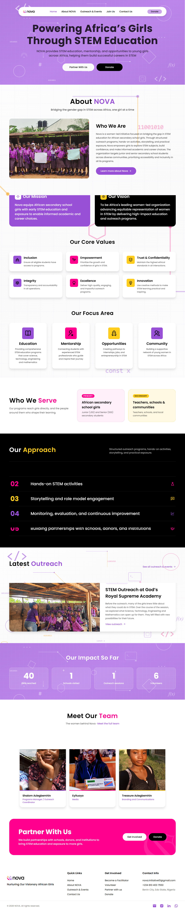

# NOVA Website 

Website for Nova, a women led initiative that brings African secondary school girls into STEM.

## Description
It contains 5 different pages such as : Home. About us , Outreahc and Events, Join us and a Contact us page.
It allows people to see more about NOVA outreachs, about, info on how to volunteer, highlights and how they can contriutee to help other girls in STEM.
THere is a also a donate page that links to paystack integrated payment pages.

Live site: https://thenovainitiative.vercel.app

## Dependencies

React.js
Tailwind CSS for styling
Remixicon for different icons on the page 

Hosted on Vercel

## Installation

git clone 
cd nova-web
npm run dev

## Notes

Forms open the visitor's email app with the message filled in; they are sent to nova.initiative01@gmail.com

Donations open Paystack payment pages in a new tab; one time and monthly

AI was used in building the About page and forms